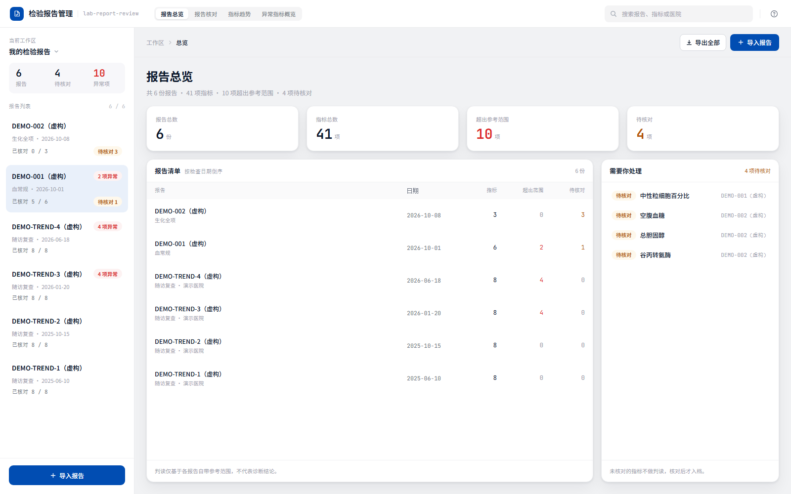
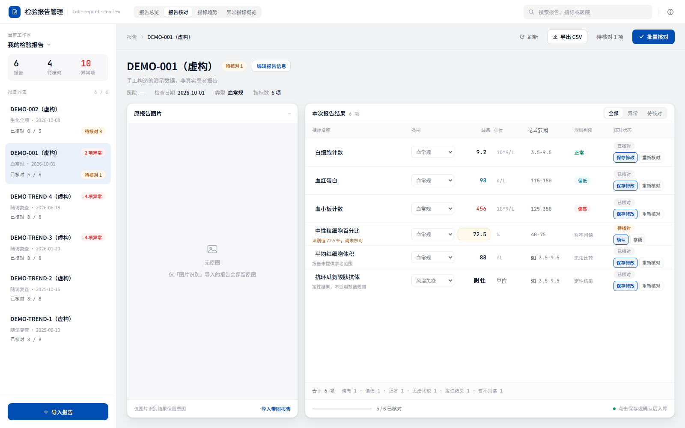
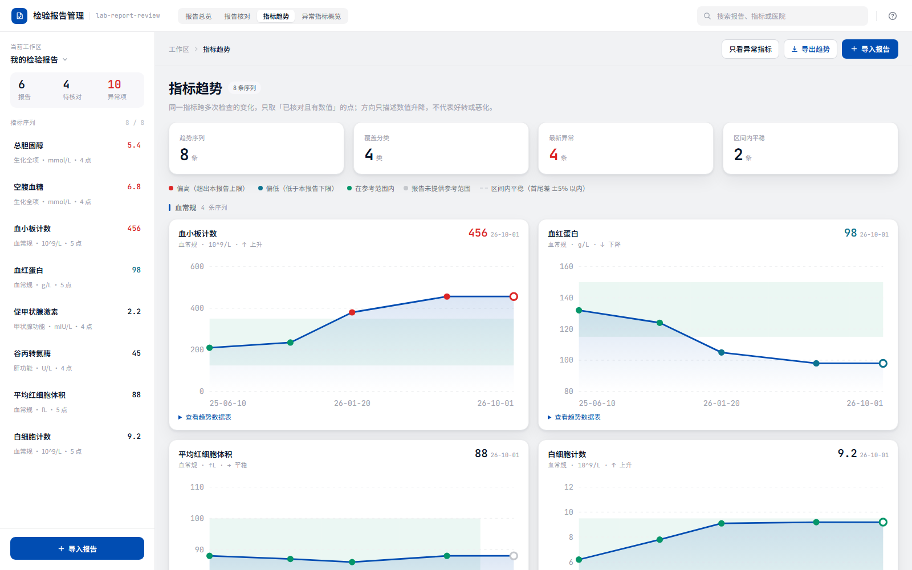
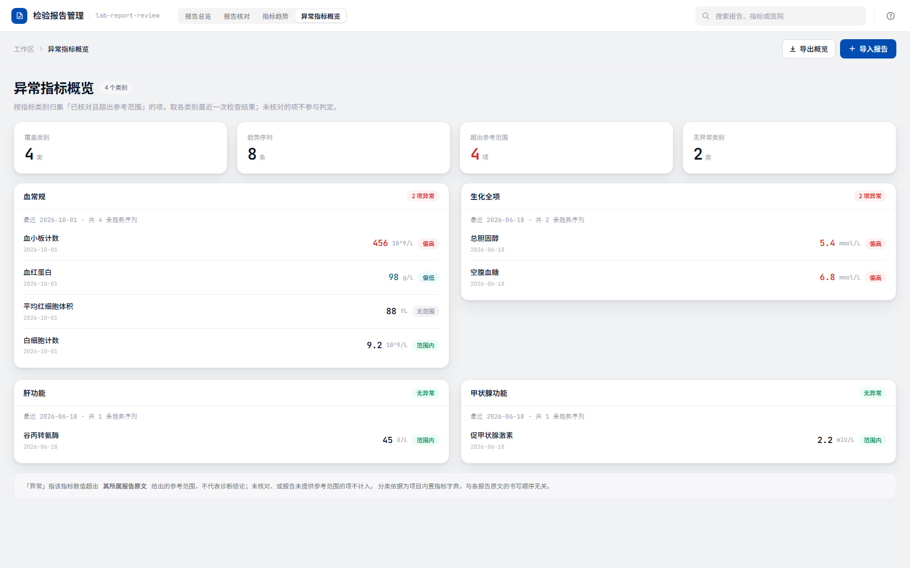

# 检验报告管理 · lab-report-review


> 把一份检验报告，变成**可核对、可追溯、不越界**的结构化数据。

演示一条最小闭环：

> 一份血检报告 → 结构化字段 → **人工核对** → **参考范围规则判断** → 总览 / 趋势可视化 → 可回看原文

核心主张不是"识别得准"，而是守三条医学边界：

1. **识别结果必须核对**：任何新进来的指标默认"待核对"，绝不自动判为正常或异常。
2. **参考范围不能乱套**：只根据"报告自带参考范围"对定量结果做范围内/偏高/偏低判断；缺范围、单位不明时不猜。阴性、阳性、加号等级等定性结果可正常核对，但明确标为“定性结果”，不套数值规则。
3. **只呈现"是否落出参考范围"，不越界下诊断**：总览与趋势只展示数值与参考范围的对比，绝不出现"你健康 / 你生病了"之类的结论，也不给出任何临床建议。

## 目录

- [界面预览](#界面预览)
- [为什么做这个项目](#为什么做这个项目)
- [技术栈](#技术栈)
- [数据导入](#数据导入)
- [趋势分析](#趋势分析)
- [快速启动](#快速启动)
- [项目结构](#项目结构)
- [隐私与数据边界](#隐私与数据边界)
- [部署与密钥安全](#部署与密钥安全)
- [已知局限](#已知局限)
- [与既有项目的区别](#与既有项目的区别)
- [开源协议](#开源协议)

## 界面预览

四个视图共用同一套外壳：顶部栏（视图切换 / 搜索）、左侧栏（报告或指标清单）、右侧内容区独立滚动。

| 报告总览 | 报告核对工作台 |
|---|---|
|  |  |
| 统计卡（总检查数 / 超出参考范围 / 待核对项）+ 按检查日期倒序的报告清单 + 待核对任务 | 左侧原报告图片，右侧可编辑的指标表格（名称 / 类别 / 结果 / 单位 / 参考范围 / 状态 / 判读） |

| 指标趋势 | 异常指标概览 |
|---|---|
|  |  |
| 同一指标跨多次检查的折线图：阶梯式参考范围带、hover 查看任意时间点的取值与该报告原文范围 | 按分类归集指标，标注各类别下的异常项与待核对项 |

> 报告核对页支持"只看异常""只看待确认"筛选；未核对的指标判读列显示「暂不判读」。
> 对报告原文中信息明确的待核对项，可先在清单中复核，再一次批量确认。定量结果要求单位完整；`阴性`、`阳性`、`弱阳性`、`1+` 至 `4+` 等明确的定性结果无需单位也可核对。任意描述、存疑内容或无法解析的参考范围会自动留给单项处理。带 `↑` / `↓` 的纯数值结果可安全识别，箭头原文仍会保留。
> 导入后发现信息有误时，可在报告标题旁点击「编辑报告信息」，更正报告标签、检查类型、检查日期和医院；原图、指标及核对状态不会改变。
> 单边参考范围会保留原始比较符：`<` / `>` 不包含临界值，`≤` / `≥`（以及 `<=` / `>=`）包含临界值。
> 以上截图均为**虚构演示数据**。

## 为什么做这个项目

- 检验报告的 OCR 与字段配对，是算法工程师的强项；而"识别结果如何被核对、如何不越界、如何可追溯"，才是临床场景里真正值钱的部分。
- 面向大众的商业健康 App 为了体验，往往牺牲可核对性与可追溯性（自动入档、补全阈值、直接给健康结论）。本项目反其道而行：宁可多一步人工确认，也不让未经核对的数据变成结论。

## 技术栈

| 层 | 技术 | 说明 |
|---|---|---|
| 后端 | Python + FastAPI | 数据模型、核对接口、规则判断、趋势聚合、导入入口 |
| 前端 | React + Vite + 原生 CSS | 四视图（报告总览 / 核对工作台 / 指标趋势 / 异常指标概览）+ 导入弹窗 + 零依赖 SVG 图表 |
| 存储 | SQLite（Python 内置 sqlite3） | 持久化，重启不丢数据；零外部依赖 |
| 数据 | 三导入入口 + 演示数据 | 文本解析/图像识别（DeepSeek）+ 表格导入（离线），见下文 |

## 数据导入

项目支持三条真实数据入口，产出统一为"待核对草稿"，共用同一套核对 / 规则 / 趋势后端：

### 1. 文本解析（AI，推荐）

粘贴检验报告的**文字内容**（复制自 App / PDF / 纸质报告），由 DeepSeek 文本模型（deepseek-v4-pro）解析成结构化字段。配置：

```bash
export DEEPSEEK_API_KEY=你的key   # 在 https://platform.deepseek.com 申请
```

- 未配置时接口返回 503 + 明确提示，前端自动降级隐藏该入口。
- 解析结果一律为"待核对草稿"，与表格导入走完全相同的核对流程。
- 模型被要求"只提取文本可见内容、不补写、不猜、指标名保留原文"。

### 2. 表格导入（默认，离线免费）

上传或粘贴 CSV（支持 UTF-8 / GBK），两种版式均可：

```csv
# 带表头
项目,结果,单位,参考范围
白细胞计数,9.2,10^9/L,3.5-9.5

# 或无表头四列 / 简单两列
白细胞计数,9.2,10^9/L,3.5-9.5
血红蛋白,98,g/L,115-150
```

字段名会自动匹配检验项别名（如 `HGB` → `血红蛋白`、`ALT` → `丙氨酸氨基转移酶`、`TSH` → `促甲状腺激素`）；单位和参考范围只保留报告原文中真实出现的内容，不会从字典补全。匹配不到的指标保留原名、标待核对。样例文件见 `backend/data/sample_lab_report.csv`。

> **指标字典说明**：`backend/data/metric_dictionary.json` 含 73 项标准指标（10 个类别，带 LOINC 编码），用于字段名归一化；字典数据整理自 [AprilYou886/healthcare](https://github.com/AprilYou886/healthcare)（MIT License）。

### 3. 图像识别（可选，需配置）

上传检验单照片，由 DeepSeek 多模态模型（deepseek-flash）识别为结构化字段。与文本解析共用同一把 `DEEPSEEK_API_KEY`。

```bash
export DEEPSEEK_API_KEY=你的key
export DEEPSEEK_VISION_MODEL=deepseek-flash   # 可选，默认就是 deepseek-flash
```

- 未配置时接口返回 503 + 明确提示，前端自动降级隐藏图片上传入口。
- **数据外传提醒**：图片识别会把图片、文本解析会把粘贴内容发送到 DeepSeek 服务；只有表格导入完全在本地处理。
- 原图会使用随机文件名保存在本机 `data/uploads/`，用于核对追溯；该目录已被 Git 忽略。默认限制为 10 MB，仅接受 PNG / JPEG / GIF / WebP，并按文件内容校验格式。
- 识别结果一律为"待核对草稿"，与文本解析/表格导入走完全相同的核对流程。
- 模型被要求"只提取图片可见内容、不补写、不猜、指标名保留原文、不提取患者姓名等个人信息"。

> 所有密钥均可写入项目根目录的 `.env` 文件（已加入 `.gitignore`，不会提交），模板见 `.env.example`。

## 趋势分析

趋势视图把**同一指标跨多次检查**串成时间序列，回答"这个指标是在变好还是变差"：

- **只统计已核对 + 有数值的点**：未核对的指标不进趋势，延续"未确认数据不下结论"的原则。
- **每个指标至少 2 个时间点**才展示，单点不构成趋势。
- **参考范围带**：图中浅绿色横向区间为该指标的参考范围，一眼看出哪些点落在范围外。
- **异常着色**：最新一次异常（偏高/偏低）的指标卡片与折线用红色，正常用蓝色。
- **纯手写 SVG 折线图**（零图表库依赖）：X 轴按真实日期等距分布，鼠标悬停或键盘聚焦可查看时间点；每张图也提供完整文本数据表。
- **趋势方向**只描述数值变化（↑上升 / ↓下降 / →平稳，变化 <5% 视为平稳），**不含任何医学解读**。

后端 `trends.py` 负责聚合：按指标名归一化分组 → 按日期排序 → 取众数作为分类/单位 → 计算方向。演示仓库内置 4 次虚构随访数据（`DEMO-TREND-*`，明确标注非真实）。

## 快速启动

> 需要**两个终端**同时运行：后端 8000（数据 / 规则 / 趋势）、前端 5173（界面）。
> 前端已配置 `/api` 代理，浏览器只访问 `http://localhost:5173` 即可。
> 运行环境：Python 3.11+；Node.js 20.19+ 或 22.12+。

### 方式一：一键启动（首次需先按「方式二」装好依赖）

依赖装好后，用仓库根目录的脚本即可，无需每次手敲命令：

| 系统 | 启动 | 停止 |
|---|---|---|
| Windows | 双击 `start.cmd` | 双击 `stop.cmd`，或直接关掉那两个服务窗口 |
| macOS / Linux | `./start.sh` | 在该终端按 `Ctrl+C` |

脚本会分别拉起后端与前端，并自动打开浏览器。Windows 下请保留弹出的
`LabReportReview-Backend` / `LabReportReview-Frontend` 两个窗口，关闭即停止服务。

> ⚠️ 同一端口同时只能有一个程序监听。若脚本报 `10048` 或
> `Port ... already in use`，说明已有服务在跑 —— 先关掉旧窗口（或执行 `stop.cmd`）再启动。

### 方式二：手动启动

### 后端（终端 1）

```bash
cd backend
python -m venv .venv
# Windows: .venv\Scripts\activate  |  macOS/Linux: source .venv/bin/activate
pip install -r requirements.txt
uvicorn app.main:app --reload --port 8000
```

接口：
- `GET /api/reports` — 报告列表（含每条的规则判断结果）
- `GET /api/reports/{id}` — 单份报告详情
- `PUT /api/reports/{id}` — 更正报告标签、检查类型、检查日期和医院
- `PUT /api/reports/{id}/analytes/{aid}` — 人工核对某条指标（定量或定性结果/单位/参考值/状态/分类）
- `POST /api/reports/{id}/batch-confirm` — 原子化批量确认选中的完整待核对项
- `GET /api/trends` — 跨报告聚合的指标趋势序列（只含已核对点）
- `POST /api/import/table` — CSV 文本导入（待核对草稿）
- `POST /api/import/table-file` — CSV 文件上传导入
- `POST /api/import/deepseek` — DeepSeek 文本解析导入（需配置密钥）
- `GET /api/import/deepseek-status` — 查询 DeepSeek 是否已配置
- `POST /api/import/ocr` — 检验单图片识别导入（需配置密钥）
- `GET /api/import/ocr-status` — 查询图片识别是否已配置

### 前端（终端 2）

```bash
cd frontend
npm ci
npm run dev   # 默认 http://localhost:5173，已配置 /api 代理到 8000
```

如需连接其他本地后端端口，可在启动前设置 `LAB_REPORT_API_TARGET`，例如
`http://127.0.0.1:8010`；该变量只影响 Vite 开发代理，不会进入浏览器构建产物。

### 测试

```bash
cd backend
pytest tests/ -q

cd ../frontend
npm test
npm run build
```

仓库包含 GitHub Actions，推送和 Pull Request 会自动运行上述后端测试、前端测试与生产构建。

测试重点覆盖以下边界情况：

- 不同指标数值相同，仍各自独立判断，不合并；
- 缺参考范围不判"正常"；
- 明确的定性结果可以核对、无需单位、保留核对后原文，但不套数值规则且不进入趋势；
- 未核对的指标不给任何判读（`interpretation = unchecked`）；
- 「还没核对」与「已核对但报告没给范围」严格区分：前者是 `unchecked`，后者才是 `no_range`，
  不会因为流程没走完就把结论说成"数据比不了"；
- 参考范围解析保守，解析不了就报错、不猜；
- 单边参考范围严格区分 `<` / `>` 与 `≤` / `≥`，临界值不会被混淆；
- 批量确认先校验全部项目再统一写入，任意一项不合格时整批不改；数值后的 `↑` / `↓` 和明确的定性结果可解析，但不会从任意文本中猜结果；
- 趋势聚合只用已核对点、单点不出趋势、方向阈值与排序正确。

## 项目结构

```
lab-report-review/
├── .github/
│   └── workflows/ci.yml    # 后端测试 + 前端测试/构建
├── .env.example            # 密钥模板（.env 已 gitignore）
├── LICENSE                 # 本项目 MIT License
├── THIRD_PARTY_NOTICES.md  # 第三方来源与许可证原文
├── data/
│   ├── lab_reports.db      # SQLite 数据库（运行时自动生成，已 gitignore）
│   └── uploads/            # OCR 原图私有目录（随机文件名，已 gitignore）
├── backend/
│   ├── app/
│   │   ├── main.py         # FastAPI 入口、核对接口、导入接口、趋势接口
│   │   ├── models.py       # 数据模型（三层状态、原始值保留）
│   │   ├── database.py     # SQLite 持久化层（建表 / 种子数据 / CRUD）
│   │   ├── storage.py      # OCR 原图类型/大小校验与本地私有存储
│   │   ├── rules.py        # 参考范围解析与规则判断
│   │   ├── trends.py       # 趋势聚合（跨报告串时间序列）
│   │   ├── ingest.py       # 导入抽象层：字段别名匹配 → 统一草稿
│   │   ├── table_import.py # CSV 表格导入入口（离线）
│   │   ├── deepseek_import.py # DeepSeek 文本解析入口（可选）
│   │   └── vision_import.py   # DeepSeek 图片识别入口（可选，deepseek-flash）
│   ├── data/
│   │   ├── metric_dictionary.json # 73 项指标字典（含 LOINC 编码）
│   │   └── sample_lab_report.csv  # 脱敏演示样例
│   └── tests/
│       ├── test_rules.py   # 规则单元测试
│       ├── test_ingest.py  # 导入层测试（匹配/解析/降级）
│       ├── test_trends.py  # 趋势聚合测试
│       ├── test_storage.py # 原图类型/大小/路径安全测试
│       ├── test_deepseek.py / test_vision.py # AI 响应解析测试
│       └── test_api.py     # API 端到端测试
└── frontend/
    ├── index.html          # 挂载点 + Noto Sans SC / JetBrains Mono（带系统字体兜底）
    ├── package.json        # React / Vite 脚本与依赖
    ├── test/               # 核对草稿、报告信息、列表排序单元测试
    └── src/
        ├── App.jsx         # 四视图（hash 路由）+ 核对表 + 弹窗 + 顶栏/侧栏外壳
        ├── tokens.css      # 设计 token 唯一来源（颜色/圆角/投影/字号）
        ├── index.css       # 全部样式（页面底色 → 中间容器透明 → 卡片）
        ├── LineChart.jsx   # 零依赖 SVG 折线图（阶梯式参考范围带 + 悬浮提示）
        ├── ImportModal.jsx # 三路导入弹窗（AI 文本 / 表格 CSV / OCR 图片）
        ├── reviewDraft.js  # 核对草稿与提交数据的纯函数
        ├── reportMetadata.js # 报告信息表单、检查类型与校验纯函数
        ├── reportList.js   # 报告日期倒序规则
        └── icons.jsx       # 内联 SVG 图标（不用 emoji / 图标字体）
```

## 隐私与数据边界

- 演示数据均为**虚构、去标识化**，不包含任何真实患者信息。
- 表格导入入口**完全本地处理**，不上传任何数据。
- 文本解析与图像识别会把相应内容发送到 DeepSeek 服务，均属可选项；未配置密钥时对应入口自动禁用。
- 数据默认落在**本地 SQLite 文件**（`data/lab_reports.db`），不上传任何服务器。
- 图片识别原图默认保存在**本地私有目录**（`data/uploads/`），通过私有缓存响应回看，且不会进入 Git。
- 无论哪种入口，识别/解析结果都只是"待核对的草稿"，不自动入档。

## 部署与密钥安全

> 本项目面向**本地运行**设计。若要放到公网，请先读完本节。

**密钥不会进入前端。** 前端代码不含任何 API Key，也不直接调用 DeepSeek —— 所有涉及密钥的
请求都由后端代发（`deepseek_import.py` / `vision_import.py` 从**服务端环境变量**读取）。
浏览器与构建产物（`dist/`）中都不存在密钥，这是架构决定的，而非依赖约定。

**但接口目前没有鉴权。** 后端尚未实现身份验证与速率限制，`POST /api/import/deepseek`
与 `POST /api/import/ocr` 属公开可调用。因此：

- ❗ **公网部署时不要配置 `DEEPSEEK_API_KEY`。** 密钥本身不会泄露，但任何知道地址的人都能
  以你的额度调用模型 —— 这是"借你的服务"而非"偷你的密钥"，同样会产生费用。
- 未配置密钥时这两个接口返回 503，前端会**自动隐藏**对应入口（已有的降级路径）。
  功能损失仅为"AI 导入不可用"；核对、规则判断、趋势等核心能力不受影响。

**公网展示的两种安全方式：**

| 方式 | 做法 | 代价 |
|---|---|---|
| 纯静态（推荐） | 只部署 `npm run build` 产物，并补一份内置演示数据作为无后端时的兜底 | 需少量改造；AI 导入不可见 |
| 全栈但不配密钥 | 部署前后端，仅**不**设置 `DEEPSEEK_API_KEY` | 需一台能跑 Python 的服务器；AI 导入自动禁用 |

仓库自带的演示数据均为虚构，两种方式都可直接用于公开演示。

## 已知局限

1. **图像识别已实测联调**：用真实生化报告单（42 项）验证，字段提取与数值/箭头核对无误；但仍只覆盖常见版式，非常规排版可能需人工修正。
2. **参考范围解析支持 `a-b` 与单边 `≤/</>/≥`**：多区间、带文字说明等复杂格式仍会明确报"无法解析"而非猜值。
3. **字段别名表覆盖 73 项**（参考开源字典，含 LOINC 编码），覆盖血常规/凝血/肝肾功能/血脂/糖代谢/电解质/甲状腺/炎症等 10 类，其余项保留原名待核对。
4. **检查类型可选择多类，但字段字典仍以常见检验指标为主**，尚未针对所有检查类型和医院版式建立专用解析规则。
5. **趋势图按指标名归一化匹配**：名称写法差异过大（如中英文混写不同）可能被视作两个指标，需人工统一命名。
6. **时区/时间只精确到日期**：趋势 X 轴按 `collected_at` 日期排布，同一天多次采样会落在同一位置。
7. **规则判断 ≠ 医学诊断**：偏高/偏低只表示"落出本报告参考范围"，不构成任何临床建议。

> 测试通过 `LAB_REPORTS_DB` 环境变量指向独立临时库（见 `tests/conftest.py`），不会污染演示数据库。

## 与既有项目的区别

| | 本项目 | 面向大众的商业健康 App |
|---|---|---|
| 核对 | 每条指标默认待核对，人工确认后才入档 | 常自动入档，核对弱化 |
| 参考范围 | 只用报告自带范围，缺失即"无法比较" | 可能套用统一/补全阈值 |
| 呈现 | 只展示数值与参考范围的对比，不做健康判定 | 常有健康评分/病情化提示 |
| 趋势 | 只用已核对数据，"上升/下降"仅为数值描述 | 常混入未确认数据并给结论 |
| 定位 | 自用工具，侧重医学边界与可追溯性 | 面向大众的健康管理产品 |

## 免责声明

本项目为个人自用的检验报告管理工具，**不用于任何临床决策，不替代医生诊断**。

## 开源协议

[MIT License](LICENSE) —— 可自由使用、修改与分发，需保留版权声明。

本项目的指标字典数据整理自 [AprilYou886/healthcare](https://github.com/AprilYou886/healthcare)（MIT License），
对应的第三方版权与许可全文见 [THIRD_PARTY_NOTICES.md](THIRD_PARTY_NOTICES.md)。
